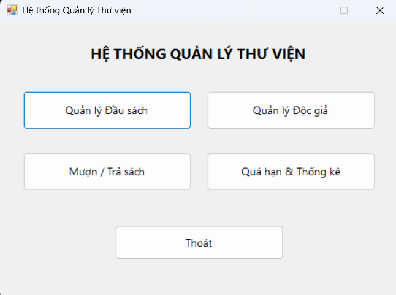
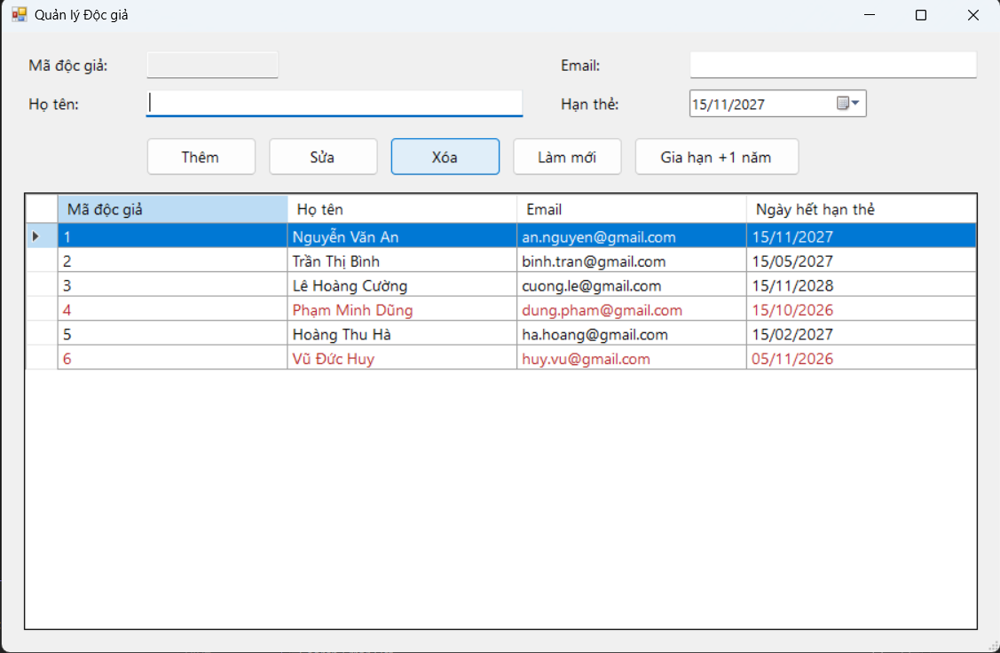
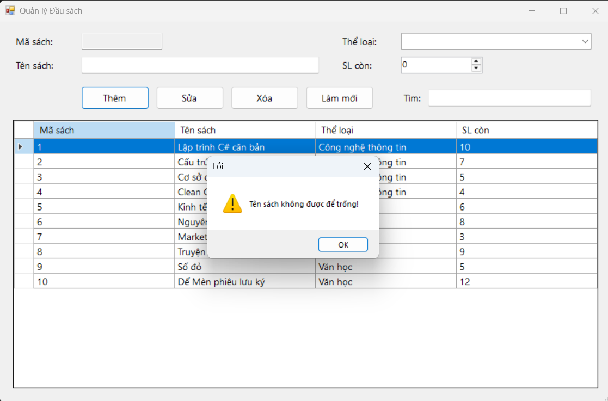
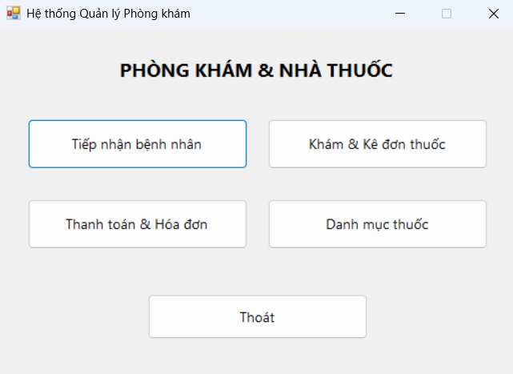
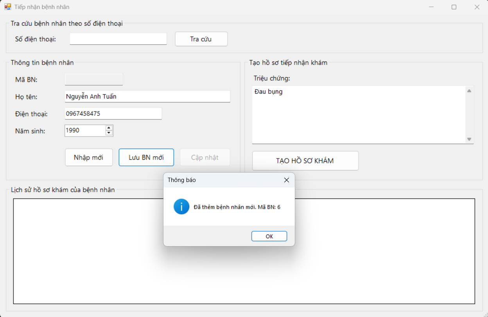
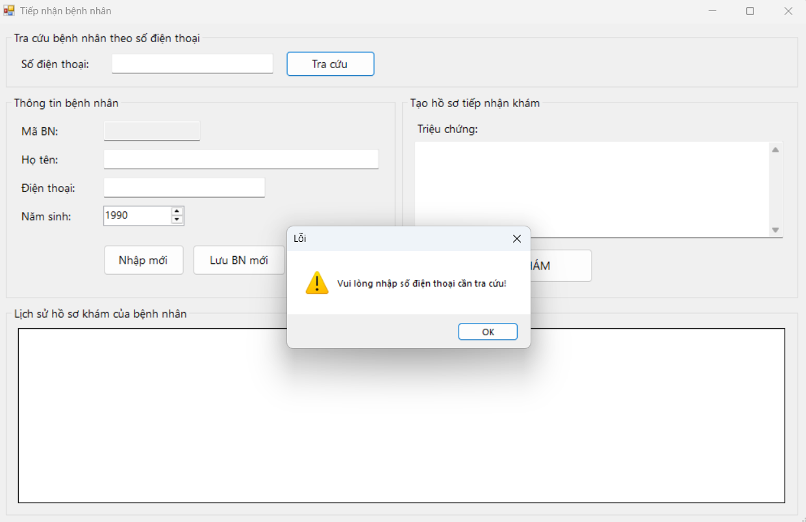
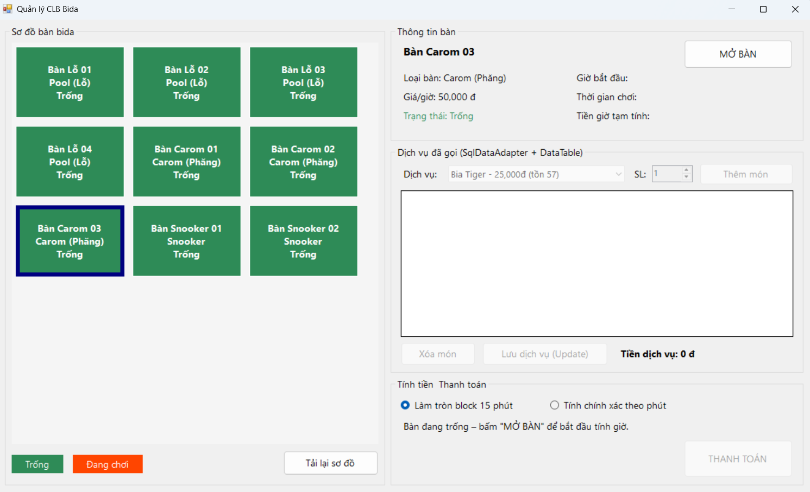
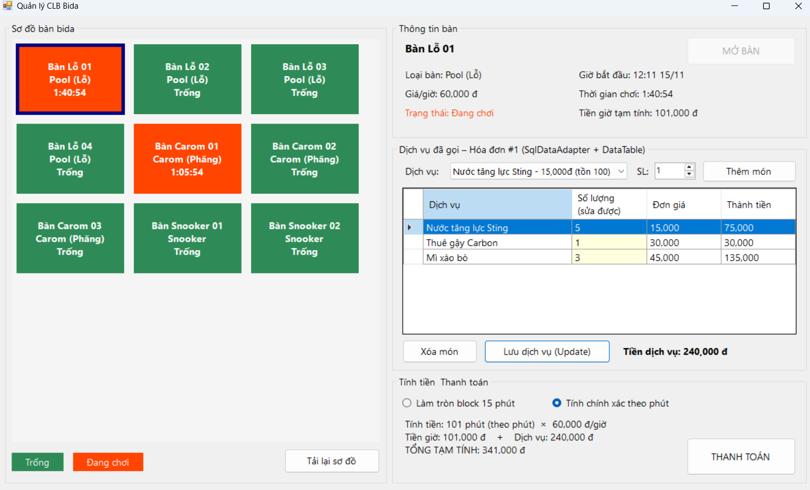

# BÁO CÁO BÀI TẬP THỰC HÀNH 6.6 - 6.7 - 6.8

## I. THÔNG TIN SINH VIÊN
* **Họ và tên:** Nguyễn Minh Trí
* **Mã số sinh viên:** 24810320227
* **Lớp: D19QTANM1**
* **Lớp học phần:** Lập trình .NET 
* **Link Repository:** https://github.com/familo23/Baitap6.6-6.7-6.8

---

## II.  KẾT QUẢ THỰC HÀNH

### Bài 6.6
### 1. Ảnh màn hình Giao diện chính

### 2. Ảnh màn hình kết quả
.png)
---------

---------
.png)
---------
.png)
---------
.png)
---------

### 3. Ảnh màn hình Kiểm tra lỗi (Validation)

---

### Bài 6.7:
### 1. Ảnh màn hình Giao diện chính

---

### 2. Ảnh màn hình kết quả

---------
.png)
---------
.png)
---------
.png)
---------
.png)
---------
.png)
---------
.png)
---------

### 3. Ảnh màn hình Kiểm tra lỗi (Validation)

---
.png)

---
### Bài 6.8:
### 1. Ảnh màn hình Giao diện chính

---
### 2. Ảnh màn hình kết quả
.png)
---------

---------
.png)
---------
.png)
---------
.png)
---------

